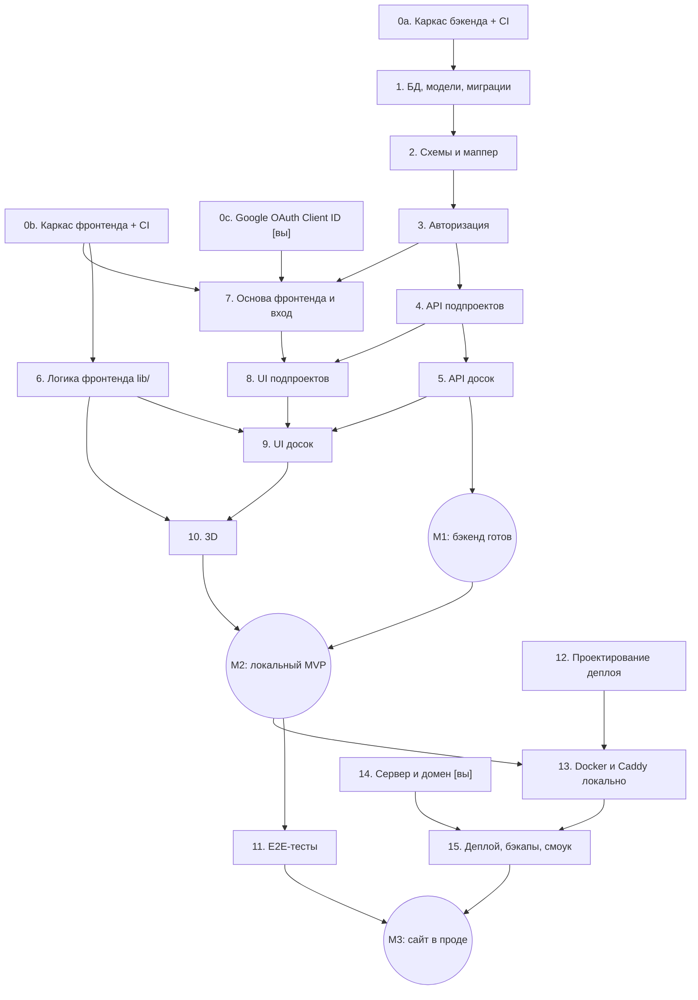

# Woodkeeper — порядок разработки и тестирования

> Дата: 2026-10-16. Связанные документы: [decisions.md](decisions.md), [data-model.md](data-model.md), [testing.md](testing.md).

## 1. Принципы

- **Тесты пишутся в том же этапе, что и код.** Этап не считается завершённым, пока его тесты не написаны и не проходят.
- **Каждый этап — отдельная ветка и pull request в `main`.** Мерж только при зелёном CI.
- **CI появляется в самом начале** (этап 0) и растёт вместе с проектом — каждый следующий этап сразу проверяется автоматически.
- **Сначала бэкенд, потом UI**, но чистую логику фронтенда (`lib/`) можно писать параллельно с бэкендом — она от API не зависит.
- **Ручные проверки — на вехах** (M1, M2, M3), а не после каждого этапа.

Обозначения: **[вы]** — задача, которую нужно выполнить вручную в Google Cloud / AWS / у регистратора домена.

## 2. Граф зависимостей

**Критический путь:** 0a → 1 → 2 → 3 → 4 → 5 → 8 → 9 → 10 → 13 → 15.

**Можно делать параллельно:**

| Что | Когда угодно, но не позже |
|---|---|
| 0b. Каркас фронтенда | этапа 6 / 7 |
| 0c. Google OAuth Client ID [вы] | этапа 7 (для бэкенда в этапе 3 не нужен — Google в тестах подменяется) |
| 6. Логика `lib/` | этапа 9 — можно писать одновременно с этапами 1–5 |
| 12. Проектирование деплоя | этапа 13 — можно после M1 |
| Покупка домена [вы] | этапа 14 |

## 3. Этапы

Для каждого этапа: что делаем → какие тесты → критерий готовности.
Ссылки на тест-кейсы — разделы [testing.md](testing.md).

---

### 0a. Каркас бэкенда + CI

**Зависит от:** —

**Делаем:**
- `backend/`: `uv init`, `pyproject.toml`, зависимости (FastAPI, SQLAlchemy, Alembic, pydantic-settings, google-auth; dev: pytest, pytest-cov, httpx, ruff, mypy).
- `app/main.py` с `GET /api/health`.
- `app/config.py` (`Settings`: `APP_ENV`, `DATABASE_URL`, `SECRET_KEY`, `GOOGLE_CLIENT_ID`), `.env.example`.
- Настройки ruff и mypy.
- GitHub Actions: job `backend` (ruff, format check, mypy, pytest).

**Тесты:** один смоук-тест `GET /api/health` → 200 (проверяет, что pytest и CI работают).

**Готово, когда:** `uvicorn` запускается локально, `/docs` открывается, CI зелёный.

---

### 0b. Каркас фронтенда + CI

**Зависит от:** —

**Делаем:**
- `frontend/`: Vite + React + TypeScript, Mantine, ESLint, Vitest + React Testing Library, MSW.
- Vite proxy `/api` → `localhost:8000`.
- GitHub Actions: job `frontend` (tsc, eslint, vitest, build).

**Тесты:** один смоук-тест компонента `App` рендерится.

**Готово, когда:** `npm run dev` открывает страницу, CI зелёный.

---

### 0c. Google OAuth Client ID [вы]

**Зависит от:** —

**Делаем:** проект в Google Cloud Console → OAuth consent screen (External, тестовый режим, свой email в test users) → OAuth Client ID типа «Web application», authorized JavaScript origin `http://localhost:5173`. Client ID → в `.env` бэкенда и фронтенда.

**Готово, когда:** Client ID есть в локальных `.env` (не в git).

---

### 1. БД, модели, миграции

**Зависит от:** 0a

**Делаем:**
- `app/db.py`: engine, `SessionLocal`, хук `PRAGMA foreign_keys=ON` и `journal_mode=WAL`, зависимость `get_db()`.
- `app/models.py`: `User`, `Project`, `Board`, `TimestampMixin`, CHECK-ограничения, каскады.
- Alembic: инициализация, первая миграция.
- `conftest.py`: фикстура временной БД.

**Тесты:** [3.6 БД](testing.md#36-бд-test_dbpy), [3.7 Миграции](testing.md#37-миграции-test_migrationspy).

**Готово, когда:** `alembic upgrade head` создаёт БД, CHECK и каскады подтверждены тестами.

---

### 2. Схемы и маппер

**Зависит от:** 1

**Делаем:**
- `app/schemas.py`: `HexColor`, `Faces`, `UserRead`, `Project*`, `Board*`, `GoogleLoginIn`.
- Маппер `Board` (6 колонок) ↔ `Faces`.

**Тесты:** [3.1 Схемы и маппер](testing.md#31-схемы-и-маппер-test_schemaspy).

**Готово, когда:** все граничные случаи валидации покрыты, roundtrip маппера проходит.

---

### 3. Авторизация

**Зависит от:** 2. Для ручной проверки с настоящим Google — ещё 0c (но не обязательно на этом этапе).

**Делаем:**
- `app/auth.py`: `verify_google_token()`, подпись/проверка cookie, `get_current_user()`.
- `routers/auth.py`: `POST /google`, `POST /logout`, `GET /me`.
- `POST /test-login` — регистрируется только при `APP_ENV=test`.
- Фикстуры `client`, `user_client`, `other_client`.

**Тесты:** [3.2 Авторизация](testing.md#32-авторизация-test_authpy) + тест, что `test-login` отсутствует при `APP_ENV=production`.

**Готово, когда:** весь цикл вход → `/me` → выход покрыт тестами с подменённым Google.

---

### 4. API подпроектов

**Зависит от:** 3

**Делаем:** `routers/projects.py` — CRUD, счётчики `boards_count` / `ordered_count`, фабрики `make_project`.

**Тесты:** [3.3 Подпроекты](testing.md#33-подпроекты-test_projectspy), часть [3.5 Доступ](testing.md#35-доступ-к-чужим-данным-test_accesspy) для проектов.

**Готово, когда:** CRUD работает через `/docs`, чужие проекты → 404.

---

### 5. API досок

**Зависит от:** 4

**Делаем:** `routers/boards.py` — список с сортировкой, создание, PATCH (включая `faces`, `is_ordered`, перенос `project_id`), удаление; фабрика `make_board`.

**Тесты:** [3.4 Доски](testing.md#34-доски-test_boardspy), остаток [3.5 Доступ](testing.md#35-доступ-к-чужим-данным-test_accesspy).

**Готово, когда:** все тест-кейсы 3.4 и 3.5 проходят, покрытие бэкенда ~90%.

---

### ◆ M1: бэкенд готов

**Ручная проверка:** через Swagger (`/docs`) с `APP_ENV=test` и `test-login` пройти сценарий: создать подпроект → добавить доску → отредактировать → отметить заказ → удалить.

---

### 6. Логика фронтенда (`lib/`)

**Зависит от:** 0b (от бэкенда не зависит — можно делать параллельно с 1–5)

**Делаем:**
- `lib/faces.ts`: коды сторон, названия, порядок материалов `BoxGeometry`, индекс грани ↔ сторона.
- Форматирование размеров и количества.
- Предзаполнение формы для дублирования.
- «Последний использованный цвет».
- Нормализация размеров модели для 3D.

**Тесты:** [4.1 Логика](testing.md#41-логика-libtestts).

**Готово, когда:** все функции чистые и покрыты unit-тестами.

---

### 7. Основа фронтенда и вход

**Зависит от:** 0b, 3, 0c

**Делаем:**
- Генерация `api/schema.d.ts` через `openapi-typescript`; npm-скрипт `gen:api`.
- `api/client.ts`: `credentials: include`, обработка 401.
- TanStack Query, React Router (`/login`, `/`), защищённый маршрут.
- `LoginPage` с кнопкой Google.
- CI: job `api-types` (типы не устарели).

**Тесты:** компонентный тест «401 → редирект на `/login`».

**Ручная проверка:** реальный вход через Google на `localhost:5173`.

**Готово, когда:** можно войти своим Google-аккаунтом и выйти.

---

### 8. UI подпроектов

**Зависит от:** 4, 7

**Делаем:** `MainPage`, `ProjectTabs` — список вкладок, создание, переименование, удаление с подтверждением; хуки `useProjects` и мутации.

**Тесты:** компонентные тесты `ProjectTabs` из [4.2](testing.md#42-компоненты-react-testing-library--msw).

**Готово, когда:** подпроектами можно полностью управлять через UI.

---

### 9. UI досок (без 3D)

**Зависит от:** 5, 6, 8

**Делаем:**
- `BoardList` (фильтр, сортировка, пустое состояние).
- `BoardCard` (размеры, количество, заметки, чекбокс «заказана», редактировать / дублировать / удалить).
- `BoardEditor` в режимах создание / редактирование / дублирование, `DimensionsFields`, `FacesEditor` с `react-colorful`.
- Обработка ошибок API в форме.

**Тесты:** компонентные тесты `BoardEditor`, `FacesEditor`, `BoardCard`, `BoardList` из [4.2](testing.md#42-компоненты-react-testing-library--msw).

**Готово, когда:** все функции работы с досками доступны через UI — без 3D.

---

### 10. 3D

**Зависит от:** 6, 9

**Делаем:**
- `BoardPreview3D`: Canvas, `OrbitControls`, 6 материалов, нормализация, подписи размеров.
- Клик по грани переключает облицовку; синхронизация с `FacesEditor`.
- Статичное превью в `BoardCard`.

**Тесты:** заглушка `BoardPreview3D` в компонентных тестах; логика уже покрыта в этапе 6.

**Ручная проверка:** раздел «3D» из [6. Ручной чек-лист](testing.md#6-ручной-чек-лист).

**Готово, когда:** ручной 3D-чек-лист пройден.

---

### ◆ M2: локальный MVP

**Ручная проверка:** весь [ручной чек-лист](testing.md#6-ручной-чек-лист), кроме входа на домене. Телефон — через локальную сеть (`vite --host`).

После M2 приложение можно использовать локально.

---

### 11. E2E-тесты

**Зависит от:** M2

**Делаем:** Playwright — запуск бэкенда с `APP_ENV=test` и чистой БД, сценарии из [5. E2E](testing.md#5-e2e-playwright); job `e2e` в CI.

**Готово, когда:** все E2E-сценарии проходят локально и в CI.

---

### 12. Проектирование деплоя

**Зависит от:** — (имеет смысл после M1)

**Делаем:** документ `docs/deploy.md` — Dockerfile, `docker-compose.yml`, Caddyfile, переменные окружения, как фронтенд попадает на сервер, бэкапы в S3, сосуществование с телеграм-ботом.

**Готово, когда:** документ согласован.

---

### 13. Docker и Caddy локально

**Зависит от:** M2, 12

**Делаем:** Dockerfile бэкенда, `docker-compose.yml`, Caddyfile; сборка фронтенда в GitHub Actions (артефакт или образ); запуск миграций при старте.

**Тесты:** локально `docker compose up` → весь CI-набор зелёный, ручной проход основного сценария на собранной версии.

**Готово, когда:** приложение работает локально в Docker так же, как в dev-режиме.

---

### 14. Сервер и домен [вы]

**Зависит от:** — (нужно к этапу 15)

**Делаем:**
- [ ] Купить домен, A-запись → IP сервера.
- [ ] Установить Docker + Compose plugin на EC2.
- [ ] Добавить swap 1–2 ГБ.
- [ ] Открыть 80/443 в Security Group.
- [ ] Проверить, что бот не занимает 80/443.
- [ ] Добавить `https://<домен>` в authorized origins Google OAuth.
- [ ] Создать S3-бакет и IAM-доступ для бэкапов.

---

### 15. Деплой, бэкапы, смоук

**Зависит от:** 13, 14

**Делаем:** первый деплой на EC2, настройка бэкапов SQLite в S3, (опционально) автоматический деплой из GitHub Actions.

**Тесты:** [7. Проверки после деплоя](testing.md#7-проверки-после-деплоя-смоук-на-сервере), включая восстановление бэкапа.

---

### ◆ M3: сайт в проде

Все вехи пройдены, E2E в CI зелёные, бэкап восстановлен хотя бы один раз.

## 4. Сводка: когда что тестируется

| Этап | Автотесты | Ручная проверка |
|---|---|---|
| 0a, 0b | Смоук-тест, CI | Запуск dev-серверов |
| 1 | `test_db`, `test_migrations` | — |
| 2 | `test_schemas` | — |
| 3 | `test_auth` | — |
| 4 | `test_projects`, `test_access` (проекты) | — |
| 5 | `test_boards`, `test_access` (доски) | — |
| **M1** | Весь бэкенд в CI | Сценарий через Swagger |
| 6 | Unit-тесты `lib/` | — |
| 7 | 401-редирект, `api-types` в CI | Реальный Google-вход локально |
| 8 | `ProjectTabs` | — |
| 9 | `BoardEditor`, `FacesEditor`, `BoardCard`, `BoardList` | — |
| 10 | (логика покрыта в 6) | 3D-чек-лист |
| **M2** | Весь фронтенд в CI | Полный ручной чек-лист, телефон |
| 11 | E2E в CI | — |
| 13 | Весь набор против Docker-сборки | Основной сценарий |
| 15 | — | Смоук на сервере, восстановление бэкапа |
| **M3** | Весь CI зелёный | — |

## 5. Критерий готовности любого этапа

- [ ] Код и тесты этапа в одной ветке.
- [ ] Все тесты этапа проходят локально.
- [ ] ruff / mypy / tsc / eslint без ошибок.
- [ ] CI в pull request зелёный.
- [ ] При изменении API — перегенерированы TS-типы.
- [ ] Если решение отличается от документации — документация обновлена в том же PR.
- [ ] PR смержен в `main`.
